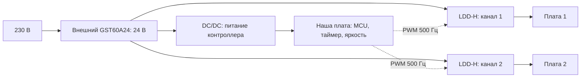

# Модули, драйверы и программное диммирование

Проверено 12 ноября 2026. Для первого прототипа Б3 выбран **Square 50 на Samsung LM301B 4000 K**: по плате есть таблица PPF, а её 50 × 50 мм можно разместить в прежнем окне головки 104 × 64 мм. Это проверка габарита платы, не готового узла: радиатор, крепёж, изоляция и провода ещё требуют компоновки.

## Три готовые платы

Данные относятся к одной плате при 700 мА. Мощность вычислена как I × типичное Vf; это электрическая мощность LED, не потребление из розетки.

| Плата и ссылка на производителя | Размеры, мм | Свет | Vf, В | Мощность, Вт | PPF, мкмоль/с | Цена в карточке |
|---|---|---|---:|---:|---:|---:|
| [Square 50, LT-3238](https://www.led-tech.de/de/49x-Samsung-LM301B-Square-50-4000k) | 50 × 50 × 4,08 | LM301B, 4000 K | 19,09 | 13,36 | 36,98 | 12,90 € |
| [COMPACT 21, LT-6469](https://www.led-tech.de/en/21x-Samsung-COMPACT-LM301-stripe-4000k) | 149 × 24 × 4,08 | LM301B, 4000 K | 8,21 | 5,75 | 17,45 | 6,49 € |
| [Линейка 98, LT-4015](https://www.led-tech.de/de/50cm-Alustreifen-mit-98x-Samsung-LM301B-LEDs-3500k-und-Steckerbuchsen) | 499,9 × 16 × 5,4 | LM301B, 3500 K | 18,99 | 13,29 | 37,63 | 19,90 € |

Карточки позволяют оформить заказ; наличие кнопки заказа не подтверждает срок отгрузки. Цены без доставки, с налогами, показанными магазином. Доставка и оплата из России не проверены. Российское наличие именно этих плат не установлено.

Все три — белые платы без добавленных UV, 660 нм и far-red/IR каналов. Это не утверждение о строго нулевом излучении вне 400–700 нм. PPF взят из таблиц изготовителя плат, а не рассчитан по рекламным ваттам или эффективности отдельного диода. Независимый протокол измерения PPF готовой платы не найден.

COMPACT требует головку длиной больше 149 мм. Линейка 98 подходит для длинного подвеса или полки. Square 50 при 350 мА даёт 19,15 мкмоль/с и потребляет около 6,52 Вт — полезная более холодная рабочая точка, но радиатор необходим и здесь.

## Что известно о пучке

У плат заявлено 120°. Для расчёта использована **диаграмма именно LM301B CRI80**, Samsung Rev.10.1, стр. 15, Ts = 25 °C, If = 65 мА на диод: [паспорт Samsung, копия у дистрибьютора](https://uploadcdn.oneyac.com/attachments/files/brand_pdf/samsungsemiconductor/B4/C9/Data_Sheet_LM301B_CRI80_Rev.10.1.pdf).

Диаграмма оцифрована с шагом 5°, усреднены левая и правая стороны. Полученный полный угол на половине максимума около 118°, согласуется с округлёнными 120° в карточке. Использована вся кривая, а не один угол. Она нормирована на полный PPF платы.

Остаются допущения: осевая симметрия отдельного LED, неизменность формы пучка при другом токе/температуре, неизменный спектр по углам и равномерно излучающая прямоугольная поверхность вместо точных координат LED. Фотометрическая относительная диаграмма переносится на фотонную при предположении об одинаковом спектре по углам. **Это не IES готового модуля и не измеренная карта PPFD нашего светильника.**

Карточки Square и COMPACT ссылаются также на LM301B EVO. Этот паспорт не использован вместо LM301B. Перед заказом стоит подтвердить фактическую ревизию LED в поставляемой партии. У линейки 98 при 2800 мА обнаружено расхождение напряжения в разных частях карточки; эта точка исключена, используемые драйверы до неё не доходят.

## Примерка драйверов

| Вариант | Подключение | Размеры драйвера, мм | Проверка для двух Square при 700 мА |
|---|---|---|---|
| [LCM-25, паспорт](https://www.meanwell.com/Upload/PDF/LCM-25/LCM-25-SPEC.PDF) | Один сетевой драйвер, платы последовательно | 105 × 68 × 23 | Не подходит: требуется 38,18 В, предел 36 В. При 500 мА типичная цепочка 37,64 В укладывается в диапазон 6–50 В. |
| [LCM-40, паспорт](https://www.mean-well.ru/uploads/files/datasheets/LCM-40.pdf) | Один сетевой драйвер, платы последовательно | 123,5 × 81,5 × 23 | Предварительно подходит: 38,18 В в диапазоне 2–57 В, 26,73 Вт на LED. |
| [LDD-700H, паспорт серии](https://www.meanwell.com/Upload/PDF/LDD-H/LDD-H-SPEC.PDF) | По одному DC/DC драйверу на плату, общий БП 24 В | 31,8 × 20,3 × 12,2 на канал | Предварительно подходит: каждая плата 19,09 В, два независимых канала. |

У LCM доступны 350/500/600/700/900/1050 мА. У LDD в калькуляторе 350/500/600/700/1000 мА — **это разные покупные модели**, а не программное переключение тока одного LDD-700H.

Для LDD выбран внешний [GST60A24-P1J, 24 В / 2,5 А / 60 Вт](https://www.meanwell.com/Upload/PDF/GST60A/GST60A-SPEC.PDF), 125 × 50 × 31,5 мм. Его нельзя подключать напрямую к этим токовым платам. Расчёт учитывает минимальные 24 В −3% и необходимые LDD 3 В запаса: допустимое типичное Vf платы до 20,28 В. В бюджете мощности заложены **условные 85% КПД LDD и 2 Вт на контроллер**; это запас для выбора БП, не результат измерения. Например, четыре Square при 700 мА превышают такой бюджет 60 Вт и блокируются.

В России найдены карточки [LDD-700H](https://www.mean-well.ru/store/LDD-700H/) и [LCM-40](https://www.mean-well.ru/store/LCM-40/) с отметкой «На складе», [LCM-серия](https://www.mean-well.ru/category/led/vnutr/DIP/seriaLCM/) включает LCM-25. За рубежом LCM есть в [каталоге LED-TECH](https://www.led-tech.de/en/search?search=lcm), адаптер — в [каталоге TME](https://www.tme.com/us/en-us/details/gst60a24-p1j/desktop-power-supplies/mean-well/). Остатки и цены меняются; покупки не выполнены.

Проверка калькулятора использует типичные Vf, рабочие окна драйверов и бюджет мощности. Она не гарантирует совместимость по максимальному холодному Vf, разбросу партии, нагреву, пульсациям, EMC или безопасности готового корпуса. Погрешности тока драйверов (LCM ±5%, LDD-H тип. ±3% при 24 В) не являются полной погрешностью PPFD.

## Наш дополнительный блок

**Для прототипа предлагается внешний БП 24 В + отдельный LDD на каждую головку + наша плата управления.** Так ток стабилизируют готовые LDD, а наша плата задаёт расписание и яркость. В калькуляторе две группы регулируются отдельно; при четырёх платах каждая группа содержит два отдельных канала с одинаковой командой.

У LDD вход DIM принимает HIGH >2,5…6 В, LOW <0,8 В относительно **−Vin**, частота 100–1000 Гц. Предлагаемые 3,3 В и 500 Гц лежат в этих пределах. Нужны определённое состояние DIM при запуске (LOW), питание MCU, разъёмы и проверка осциллографом. LDD действительно переключает выходной ток импульсами: приближённо `PPF_средний = PPF_при_токе × duty`. Влияние изменившейся температуры не рассчитано. Мерцание для человека и съёмки ещё нужно проверить; выбор 500 Гц не является подтверждением отсутствия мерцания.

Для LCM наша плата управляет входом DIM через отдельный изолированный интерфейс 0–10 В либо 10 В PWM 100–3000 Гц; 3,3 В GPIO напрямую не подходит. **DIM− нельзя соединять с −V LED.** Драйверы LCM не предназначены для добавления другого токового драйвера между их выходом и LED. Вспомогательные 12 В / 50 мА LCM-40 не приняты за достаточное питание MCU с радио.

У LCM DIM меняет величину постоянного тока. Поэтому калькулятор сначала вычисляет ток, затем интерполирует PPF в таблице платы. Две Square при 700 мА и DIM 50% дают около 38,30 мкмоль/с; два LDD-700H при PWM 50% — около 36,98 мкмоль/с. Это разные режимы. У LCM область 0…6% не определена, кроме состояния выключения; ниже минимального тока таблицы платы PPFD не вычисляется. Нужны замеры, если важно использовать этот диапазон.

Схемы выше — архитектуры для разработки, без выбора всех компонентов, разводки PCB и готовой прошивки.

## Что ещё измерить

Чтобы оценить именно Б3, нужен прототип с выбранной платой, радиатором и куполом. Для каждого из трёх раскрытий: зафиксировать высоту, ток, температуру, измерить PPFD по сетке на кроне и за её границами, повторить на нескольких высотах и уровнях DIM. Для количественной доли всего ушедшего в стороны потока нужна достаточно полная угловая/пространственная выборка; одной точки или маленькой сетки недостаточно. Спектр/люксы и яркость в направлении глаз измеряются отдельно для человеческой зоны.

После этого можно заменить диаграмму диода картой всей сборки и оценить расхождение расчёта с измерениями. Сейчас калькулятор не выдаёт выдуманный общий процент точности или потерь купола.
